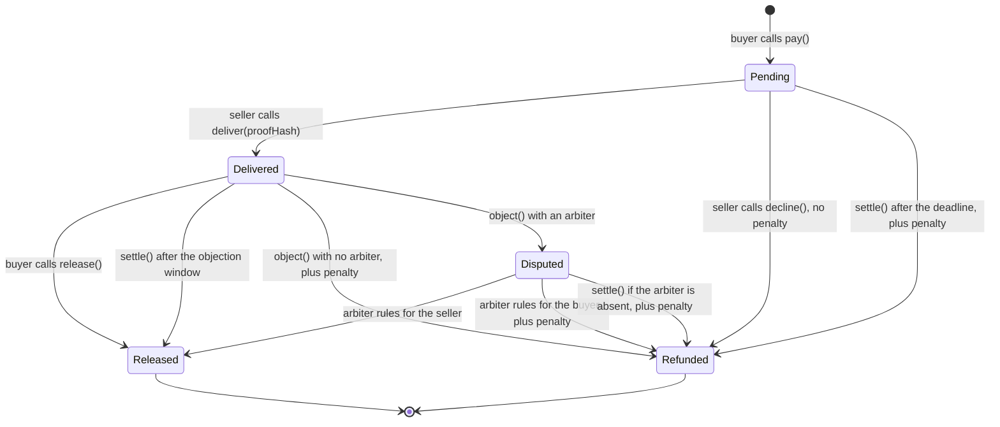
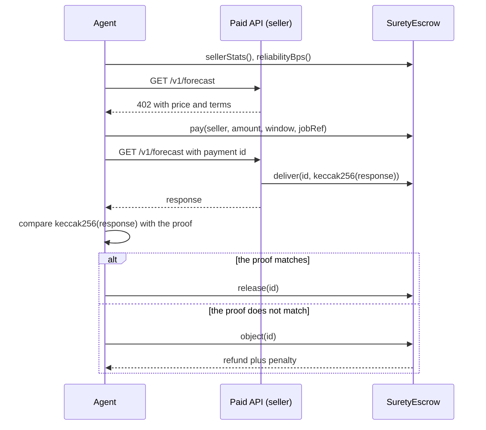

# Surety

Bonded, self-settling USDC payments for AI agents and humans on [Arc](https://docs.arc.io).

**Live app:** https://surety-arc.pages.dev (a preview until the contract goes live on Arc mainnet)

## The problem

Agents now pay for APIs per call with x402. These payments are final. If the API takes the money and returns nothing, the agent has no refund and no dispute path.

## The solution

A seller posts a USDC bond. A buyer pays into escrow, not into the seller's wallet. The seller must post a delivery proof before the deadline.

- If the seller stays silent, anyone can settle. The buyer gets a full refund plus a penalty from the bond.
- If the seller delivers, the buyer has an objection window. If the buyer does not object, anyone can settle, and the seller gets paid.
- Each outcome goes into an onchain record. An agent reads the seller's reliability score before it pays.

The same contract covers a human case: **pay-for-a-reply**. A payment to a person refunds itself if the person does not reply in time.

## How it works





### Contract

[`contracts/src/SuretyEscrow.sol`](contracts/src/SuretyEscrow.sol) is one contract with no owner, no upgrade path, and no fee.

| Function | Caller | Effect |
| :- | :- | :- |
| `register(penaltyBps, minDeliveryWindow, objectionWindow, arbiter)` | seller | Sets permanent terms |
| `addBond(amount)`, `withdrawBond(amount)` | seller | Moves USDC in and out of the unlocked bond |
| `pay(seller, amount, deliveryWindow, jobRef)` | buyer | Escrows USDC and locks the penalty in the bond |
| `deliver(id, proofHash)` | seller | Records the proof and starts the objection window |
| `decline(id)` | seller | Refunds a job before the deadline, with no penalty |
| `release(id)` | buyer | Accepts a delivery early |
| `object(id)` | buyer | Objects during the objection window |
| `resolve(id, refundBuyer)` | arbiter | Decides an objection |
| `settle(id)` | anyone | Finishes a payment after its deadline |
| `claim()` | anyone | Collects a payout that a failed transfer left behind |
| `sellerStats`, `reliabilityBps`, `freeBond`, `getPayment` | anyone | Read the onchain record |

### Arc details

- All amounts use the 6-decimal ERC-20 interface of USDC at `0x3600000000000000000000000000000000000000`. The contract never reads `msg.value` or a native balance. The constructor rejects a token that does not report 6 decimals.
- USDC can block an address. A blocked recipient cannot freeze a payment: the failed payout becomes a claim, and the payment still finishes.
- The clients set `maxFeePerGas` above the 20 gwei floor, because Arc drops lower transactions without an error.
- The clients estimate gas with no fee fields. With a fee and no gas limit, the node reserves the block gas limit times the fee from the sender. This reservation shares a balance with the USDC being moved, so a valid transfer can fail the estimate.

### Known limits

- **The MVP objection rule trusts the buyer.** A seller with no arbiter loses the payment and the penalty on any objection, even after honest delivery. A dishonest buyer can abuse this. Sellers should name an arbiter. The agent demo shows the honest use: the agent objects only if the hash check fails.
- **A proof hash is a commitment.** It proves what the seller posted, not that the work is good.
- **A score can be washed.** A seller can pay itself from a second wallet. The bond size and payment history help, but they are not proof.

## Deployments

<!-- MAINNET:START -->
Mainnet values appear here after `scripts/mainnet.sh` runs.
<!-- MAINNET:END -->

<!-- TESTNET:START -->
Testnet values appear here after `scripts/testnet.sh` runs.
<!-- TESTNET:END -->

## How Arc Studio was used

See [SUBMISSION.md](SUBMISSION.md) and [STUDIO_STEPS.md](STUDIO_STEPS.md).

## Run it

You need Node 22 or later and [Arc Foundry](https://docs.arc.io/arc/tutorials/install-arc-foundry.md).

```sh
npm ci
npm run test:contracts          # Foundry tests
cp .env.example .env            # add four new wallets
scripts/local.sh                # full flow on a local Arc node, real USDC contract
scripts/local.sh --keep         # the same, and leave the node up for the app
npm run dev                     # app at http://localhost:5173
```

On a live network:

```sh
scripts/testnet.sh              # deployer needs testnet USDC from faucet.circle.com
scripts/mainnet.sh              # deployer needs 2.40 USDC or more
```

Each script stops before it spends anything if the deployer is short of funds. Each script reuses an existing deployment, funds the demo wallets, runs the agent demo, and writes the real addresses and hashes into this file.

The app is a static site on Cloudflare Pages. The build reads the contract address from `app/src/contract/deployments.json`, so run this after `scripts/mainnet.sh`:

```sh
npx wrangler login
scripts/publish.sh              # rebuilds the app and deploys it to surety-arc.pages.dev
```

## Repository

| Path | Content |
| :- | :- |
| `contracts/` | SuretyEscrow, Foundry tests, deploy script |
| `app/` | Vite, React, and viem web app |
| `agent/` | Mock paid API, buyer agent, and the demo run |
| `scripts/` | One-command flows for local, testnet, mainnet, Studio, and publish |
| `studio/` | The prompts for Arc Studio |

## License

MIT
