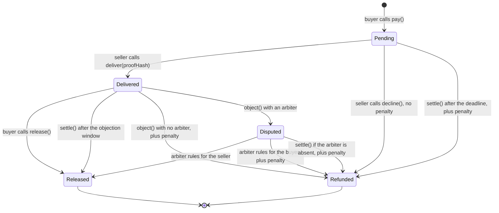
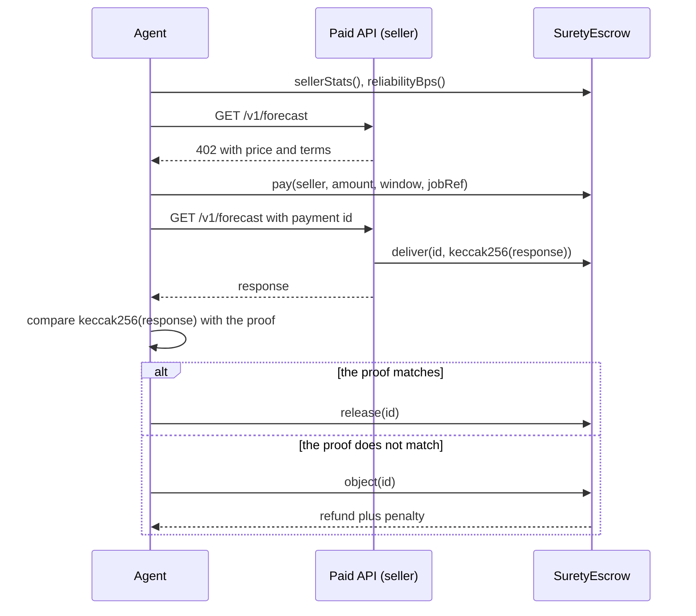

# Surety

**Sellers post collateral, and failure costs them.**

**Silence pays the seller, failure pays the buyer, anyone can settle.**

Surety is a settlement layer on [Arc](https://docs.arc.io) for paid APIs and agent work. It is not a marketplace. Any agent marketplace or x402 seller can plug into it. A seller posts a USDC bond, and a buyer pays into escrow. If the buyer stays silent after delivery, the seller gets paid. If the seller fails, the buyer gets a full refund plus a penalty from the bond. No keeper, platform, or owner holds the funds, and the contract charges no fee.

**Live app:** https://surety-arc.pages.dev (reads the live contract on Arc mainnet)

**Contract:** [`0x2f10d55cfd39eccc7f86ba95d7d0026799fc67f3`](https://explorer.arc.io/address/0x2f10d55cfd39eccc7f86ba95d7d0026799fc67f3?tab=contract) on Arc mainnet, source verified

**Arc Studio workspace:** https://studio.arc.io/app/6c3d23f8-e939-4065-8dc8-a6d2cd9cb612

## Three stories on mainnet

Each story moved real USDC through the live contract.

| Story | What happened | Result | Transaction |
| :- | :- | :- | :- |
| Honest seller | The seller posted the proof. The agent checked `keccak256(response)` against the proof and released the payment | Seller got 0.05 USDC | [release](https://explorer.arc.io/tx/0xb6362577f1cca6796f97882c8496ce7186d2010f4beff50703e621d34c435ac6) |
| Silent seller | The seller took the payment and never delivered. `settle` ran after the deadline | Buyer got 0.05 USDC back plus a 0.005 USDC penalty | [settle](https://explorer.arc.io/tx/0xc0b15a93d0e98e93f86412b5643a3e01dd2f275e535e8f05d16195b86b513020) |
| Lying seller | The seller posted a proof for one response and served another. The hash check failed, so the agent objected | Buyer got 0.05 USDC back plus a 0.005 USDC penalty | [object](https://explorer.arc.io/tx/0x29bd5b2417dac0a6349a08edcd1f2d084c7f5fc9087ccecfec0ea238499c6bfc) |

## The onchain record

Each outcome goes into a record that anyone can read with `sellerStats` and `reliabilityBps`. An agent reads the record before it pays, and it refuses a seller below its floor. In the demo, the agent refused the bad seller after these failures, and no money moved.

| Seller | Reliability | Delivered | Refunded | Objected | Declined | Bond |
| :- | :- | :- | :- | :- | :- | :- |
| Honest seller [`0x1614E03f4f896065051649E06E7Fe07719b48fc0`](https://explorer.arc.io/address/0x1614E03f4f896065051649E06E7Fe07719b48fc0) | 100% | 5 | 0 | 0 | 1 | 1 USDC |
| Bad seller [`0x741972f20b169Cb6310c40F73eE8A19577AaF1ed`](https://explorer.arc.io/address/0x741972f20b169Cb6310c40F73eE8A19577AaF1ed) | 0% | 0 | 3 | 1 | 0 | 0.239 USDC |

The demo wallets belong to this project, so this record shows that the mechanism works. It does not show outside demand. See "Known limits and Phase 2."

## The problem

Agents now pay for APIs per call with x402. These payments are final. If the API takes the money and returns nothing, the agent has no refund and no dispute path.

The same gap exists between people. The same contract covers this case: **pay-for-a-reply**. A payment to a person refunds itself if the person does not reply in time.

## Plug in

Surety adds one settlement step to a paid API. The seller keeps its service, its customers, and its price.

1. **Register once.** The seller sets a penalty, a delivery window, and an objection window, and posts a bond.
2. **Quote.** The API answers HTTP 402 with the seller, the amount, and a job reference.
3. **Deliver.** When a call arrives with a Surety payment id, the API does the work and calls `deliver()` with the hash of the response.

A marketplace can use the same three steps for each listing, and show the onchain record beside the price.

[`agent/seller-api`](agent/seller-api) is a working example: a paid API with about 200 lines of code. The server delivers, declines, and settles by itself. Today it uses an HTTP 402 flow in the style of x402, with a Surety header. It does not use the x402 wire format or a facilitator yet.

Three real calls ran against this server on Arc mainnet on October 31, 2026. The server sent every seller transaction by itself.

| Call | What happened | End state | Transactions |
| :- | :- | :- | :- |
| 1. Buyer verifies | The agent paid 0.02 USDC, and the server did the work and posted the hash. The agent checked the hash and the reported balance, then released | Seller paid | [pay](https://explorer.arc.io/tx/0x830367ccf597d4a5067308a9e53a9f949c0001b34bc8f4b16ff5799c4d30c4ea), [deliver](https://explorer.arc.io/tx/0x0ad8093a140eb647d6bd71c07245ade9a832db065c231ffc0778c69e60078b67), [release](https://explorer.arc.io/tx/0x17085116c4dd4d88b059952aafe8463453c0a3d630f0754ea64bff32c89fda13) |
| 2. Silence pays the seller | The agent took the result and did nothing. The server settled after the objection window | Seller paid | [pay](https://explorer.arc.io/tx/0x17df13ff33caf620d3df6810dbb49e2f34448ac524a783a1213dede0c4c390a0), [deliver](https://explorer.arc.io/tx/0xc0f2f7ae8b2d6d72ed6e89ca256d14db307b904ed830564ff4d6ddc8741d006b), [settle](https://explorer.arc.io/tx/0xd71e1a061eaa75a90426a9e20ea2056ead34831c70ede3d3ecb21129415f12ae) |
| 3. Payment with no call | The agent paid and never called the API. The server declined before the deadline | Buyer refunded, no penalty, bond intact | [pay](https://explorer.arc.io/tx/0x44525627cbd7b0b4b22706a7d1d2584a5e5948500b80e3976c8c3d90803c863b), [decline](https://explorer.arc.io/tx/0x0ed89f28b22f9faf49c931bb520978626c81e134f6e6d9360d8f80f27a528253) |

The first run stopped on an HTTP 429 from the public RPC, after delivery and before `release`. No funds were at risk, because a silent buyer pays the seller. The agent then released payment 7, and the run continued from call 2. The full log is in [`agent/runs/seller-api-mainnet-output.txt`](agent/runs/seller-api-mainnet-output.txt).

## How Surety compares

Each project below solves a real part of this problem. Surety adds one thing: the seller has money at risk before the job starts. Surety can sit under a marketplace, and a measurement service can read its record. The table comes from each project's public docs and contracts, read on October 31, 2026.

| Project | What it does | Seller bond | When the seller fails |
| :- | :- | :- | :- |
| [Arcurrent](https://github.com/angelraph/arcurrent) (Round 1) | Open escrow with an onchain reputation ledger, plus a treasury agent | None | With no proof, the funder gets a refund after the deadline. After proof, only the funder can release |
| [vet402](https://github.com/kzmttkc/vet402) (Round 1) | Buys from x402 sellers with its own funds and publishes the delivery rates | None. It measures and does not escrow a buyer's payment | A buyer sees the rate before paying. The payment itself stays final |
| [SiteCheck](https://github.com/bck-stack/sitecheck-x402) (Round 1) | Pay-per-call tools for agents, with the rule "pay only for results" | None | If a handler reports a failure, the payment does not settle. The rule covers one seller's own tools |
| [ShwUp](https://github.com/successaje/shwup) (Round 1) | Refundable RSVP deposits for events | Not applicable. The guest posts the deposit | A guest who does not come forfeits the deposit. This is the same idea, for guests and not for sellers |
| [Tolly ACP](https://explorer.arc.io/address/0x75db32f542f981ca4e545a5b35379e3735104a65) | ERC-8183 job escrow on Arc, gated by an evaluator | None | The evaluator rejects, or anyone refunds after expiry. The buyer gets the budget back. A completed job pays a 10% platform fee. Its reputation setting is off, per `GET /v1/acp` |
| **Surety** | Bonded settlement for paid calls and jobs, with no evaluator and no fee | Yes, set by the seller | Buyer gets a full refund plus the penalty, and the failure goes into the onchain record |

## How it works





### Contract

[`contracts/src/SuretyEscrow.sol`](contracts/src/SuretyEscrow.sol) is one contract with no owner, no upgrade path, and no fee.

| Function | Caller | Effect |
| :- | :- | :- |
| `register(penaltyBps, minDeliveryWindow, objectionWindow, arbiter)` | seller | Sets permanent terms |
| `addBond(amount)`, `withdrawBond(amount)` | seller | Moves USDC in and out of the unlocked bond |
| `pay(seller, amount, deliveryWindow, jobRef)` | buyer | Escrows USDC and locks the penalty in the bond |
| `deliver(id, proofHash)` | seller | Records the proof and starts the objection window |
| `decline(id)` | seller | Refunds a job before the deadline, with no penalty |
| `release(id)` | buyer | Accepts a delivery early |
| `object(id)` | buyer | Objects during the objection window |
| `resolve(id, refundBuyer)` | arbiter | Decides an objection |
| `settle(id)` | anyone | Finishes a payment after its deadline |
| `claim()` | anyone | Collects a payout that a failed transfer left behind |
| `sellerStats`, `reliabilityBps`, `freeBond`, `getPayment` | anyone | Read the onchain record |

### Arc details

- All amounts use the 6-decimal ERC-20 interface of USDC at `0x3600000000000000000000000000000000000000`. The contract never reads `msg.value` or a native balance. The constructor rejects a token that does not report 6 decimals.
- USDC can block an address. A blocked recipient cannot freeze a payment: the failed payout becomes a claim, and the payment still finishes.
- The clients set `maxFeePerGas` above the 20 gwei floor, because Arc drops lower transactions without an error.
- The clients estimate gas with no fee fields. With a fee and no gas limit, the node reserves the block gas limit times the fee from the sender. This reservation shares a balance with the USDC being moved, so a valid transfer can fail the estimate.

## Known limits and Phase 2

The mainnet contract cannot change, so each fix below needs a new deployment. Use small amounts.

| Limit | Risk today | Phase 2 fix |
| :- | :- | :- |
| **Unfair buyer objection (SE-02)** | A seller with no arbiter loses the payment and the penalty on any objection, even after honest delivery. A dishonest buyer can abuse this. The agent demo shows the honest use: the agent objects only if the hash check fails | A buyer objection deposit plus an arbiter. A seller can name an arbiter today. The deposit needs a new contract |
| **Unsolicited payments lock bond (SE-03)** | Anyone can pay a registered seller. This locks free bond and forces the seller to deliver or call `decline`. A seller who ignores it loses the penalty. The seller API declines these payments, but only while it runs | Seller opt-in or an allowlist |
| **Fake reputation through self-dealing** | A seller can pay itself from a second wallet and raise its score. The bond size and payment history help, but they are not proof. The demo record comes from this project's own wallets | Count distinct funded buyers |
| **No independent audit** | The Arc Studio review is not an independent audit. See [`contracts/AUDIT.md`](contracts/AUDIT.md) for the review and its open items | A third-party audit before larger amounts |

Two more limits stay after Phase 2:

- **A proof hash is a commitment.** It proves what the seller posted, not that the work is good.
- **The USDC issuer can block the escrow.** If this happens, all funds in the contract stop until the issuer unblocks it. The contract handles a blocked recipient, but not a block on itself.

## Deployments

<!-- MAINNET:START -->
**Arc Mainnet** (generated from real receipts by `agent/src/report.ts`)

- SuretyEscrow: [`0x2f10d55cfd39eccc7f86ba95d7d0026799fc67f3`](https://explorer.arc.io/address/0x2f10d55cfd39eccc7f86ba95d7d0026799fc67f3)
- Deployment: [`0x47efbd44a5fd531bcd8cd9b28356f71a529fb34162cc76c8e0b5f92d1af951b1`](https://explorer.arc.io/tx/0x47efbd44a5fd531bcd8cd9b28356f71a529fb34162cc76c8e0b5f92d1af951b1)
- Honest seller [`0x1614E03f4f896065051649E06E7Fe07719b48fc0`](https://explorer.arc.io/address/0x1614E03f4f896065051649E06E7Fe07719b48fc0): 100% reliable, 5 delivered, 0 refunded, bond 1 USDC
- Bad seller [`0x741972f20b169Cb6310c40F73eE8A19577AaF1ed`](https://explorer.arc.io/address/0x741972f20b169Cb6310c40F73eE8A19577AaF1ed): 0% reliable, 0 delivered, 3 refunded, bond 0.239 USDC

| Step | Transaction |
| :- | :- |
| deployer funds AGENT | [`0x765cdb36a14759600d549dba61fd9c7b2fa985916a7f132d4cdb6955a673769f`](https://explorer.arc.io/tx/0x765cdb36a14759600d549dba61fd9c7b2fa985916a7f132d4cdb6955a673769f) |
| deployer funds SELLER | [`0x4847b1406a9528a533f7afcc2082f773f9d211df9f83322dc9d8324befbf4032`](https://explorer.arc.io/tx/0x4847b1406a9528a533f7afcc2082f773f9d211df9f83322dc9d8324befbf4032) |
| deployer funds BAD_SELLER | [`0xfb76bcc427211f2cf160b22ed877efa3d397891bef34c8a1c1af711963f9c3ee`](https://explorer.arc.io/tx/0xfb76bcc427211f2cf160b22ed877efa3d397891bef34c8a1c1af711963f9c3ee) |
| honest seller registers | [`0xecfe1ca497bc5ab2ba04bef2c85c033b3fa866ff1d32661fb9440509ce9ca27c`](https://explorer.arc.io/tx/0xecfe1ca497bc5ab2ba04bef2c85c033b3fa866ff1d32661fb9440509ce9ca27c) |
| honest seller approves bond | [`0x683f2be64735025001e6b4e909c4f4cb061ecf058c6e34f41c4a65821175eaca`](https://explorer.arc.io/tx/0x683f2be64735025001e6b4e909c4f4cb061ecf058c6e34f41c4a65821175eaca) |
| honest seller posts 1 USDC bond | [`0x5d1eaf0957d1d89750e607d005030f2de535c0c5b77d387ff5a888d459be0f4e`](https://explorer.arc.io/tx/0x5d1eaf0957d1d89750e607d005030f2de535c0c5b77d387ff5a888d459be0f4e) |
| bad seller registers | [`0xb4cb33bcbf35196cdb7b9bf4ac79e9803437f805517033b29ab3f53433627129`](https://explorer.arc.io/tx/0xb4cb33bcbf35196cdb7b9bf4ac79e9803437f805517033b29ab3f53433627129) |
| bad seller approves bond | [`0x7ebb3ef8e266e99881c972f247e6f6d94045b8650dcc538bc7956c776c279fcd`](https://explorer.arc.io/tx/0x7ebb3ef8e266e99881c972f247e6f6d94045b8650dcc538bc7956c776c279fcd) |
| bad seller posts 0.25 USDC bond | [`0x4e5c2e0c676822f642c16c56ed06dd6d5202487930aa662685c75ff95c98ad92`](https://explorer.arc.io/tx/0x4e5c2e0c676822f642c16c56ed06dd6d5202487930aa662685c75ff95c98ad92) |
| agent approves USDC | [`0x6c71aced2343f277042f69a955ad95ce8f290b524f7275fd2d39e44dcdce716f`](https://explorer.arc.io/tx/0x6c71aced2343f277042f69a955ad95ce8f290b524f7275fd2d39e44dcdce716f) |
| agent pays through Surety | [`0x6bd5cbc7b663dcd6deb7b771c508991564fb227a5bfb5416d257b6abb7c54c5d`](https://explorer.arc.io/tx/0x6bd5cbc7b663dcd6deb7b771c508991564fb227a5bfb5416d257b6abb7c54c5d) |
| honest seller delivers payment 1 | [`0x25e5e3c22b1dbc0a6ae187dad59987ce7c761939d8ce44b350293407c85f0c5a`](https://explorer.arc.io/tx/0x25e5e3c22b1dbc0a6ae187dad59987ce7c761939d8ce44b350293407c85f0c5a) |
| agent releases payment 1 | [`0xb6362577f1cca6796f97882c8496ce7186d2010f4beff50703e621d34c435ac6`](https://explorer.arc.io/tx/0xb6362577f1cca6796f97882c8496ce7186d2010f4beff50703e621d34c435ac6) |
| agent pays through Surety | [`0x4adecf7dce92a8c2523b2e8dfa4f208b88d50a3e2aea9684a54874a8af53dcee`](https://explorer.arc.io/tx/0x4adecf7dce92a8c2523b2e8dfa4f208b88d50a3e2aea9684a54874a8af53dcee) |
| honest seller delivers payment 2 | [`0x1f7717e0676a82e5b999aa63d5ad2ceec7b9b7cdba13a994a9ef161d25aa4322`](https://explorer.arc.io/tx/0x1f7717e0676a82e5b999aa63d5ad2ceec7b9b7cdba13a994a9ef161d25aa4322) |
| settle payment 2 | [`0xca472cafa636011fabc04c2fa3e20739770929877fdfb8026b70b38824800c6c`](https://explorer.arc.io/tx/0xca472cafa636011fabc04c2fa3e20739770929877fdfb8026b70b38824800c6c) |
| agent pays through Surety | [`0x349c3d3f13080ea202b9067f7492ab7edf9a5e10e68f7038316b2f0f33ee1f87`](https://explorer.arc.io/tx/0x349c3d3f13080ea202b9067f7492ab7edf9a5e10e68f7038316b2f0f33ee1f87) |
| settle payment 3 | [`0xc0b15a93d0e98e93f86412b5643a3e01dd2f275e535e8f05d16195b86b513020`](https://explorer.arc.io/tx/0xc0b15a93d0e98e93f86412b5643a3e01dd2f275e535e8f05d16195b86b513020) |
| agent pays through Surety | [`0xc09da5867017d5fdc23db8e7ca97cad1e8e4823c0ca0b569c431a4fdae07e7cb`](https://explorer.arc.io/tx/0xc09da5867017d5fdc23db8e7ca97cad1e8e4823c0ca0b569c431a4fdae07e7cb) |
| bad seller delivers payment 4 | [`0x68ec358115159337ed4b97e4ab31f2241371166ec2855014d1122c3c2b127445`](https://explorer.arc.io/tx/0x68ec358115159337ed4b97e4ab31f2241371166ec2855014d1122c3c2b127445) |
| agent objects to payment 4 | [`0x29bd5b2417dac0a6349a08edcd1f2d084c7f5fc9087ccecfec0ea238499c6bfc`](https://explorer.arc.io/tx/0x29bd5b2417dac0a6349a08edcd1f2d084c7f5fc9087ccecfec0ea238499c6bfc) |
| payer pays for a reply | [`0x70a2c0d30c2c70fe519b8c5f46c4fe4aa7841c687038238b9fd025eae64d2f8d`](https://explorer.arc.io/tx/0x70a2c0d30c2c70fe519b8c5f46c4fe4aa7841c687038238b9fd025eae64d2f8d) |
| recipient replies to payment 5 | [`0x22ff8b714a2cc1df31df6a9b45fa9350f7b046c834b75179624eb393bfe84ff3`](https://explorer.arc.io/tx/0x22ff8b714a2cc1df31df6a9b45fa9350f7b046c834b75179624eb393bfe84ff3) |
| agent releases payment 5 | [`0xf3c0ccb528cf124e5fd9d90614a5614df900c16a6ec3dd0d8a233530ef45c40b`](https://explorer.arc.io/tx/0xf3c0ccb528cf124e5fd9d90614a5614df900c16a6ec3dd0d8a233530ef45c40b) |
| payer pays for a reply | [`0x8be088e398ddaee97fed4d9a1f56f33e27f4a3fe1f6c057ed6831476f3bd6eda`](https://explorer.arc.io/tx/0x8be088e398ddaee97fed4d9a1f56f33e27f4a3fe1f6c057ed6831476f3bd6eda) |
| settle payment 6 | [`0x11ca9cfc54f22f0522e6982b993f7c07d4519e74bc1635f04a4a9eda780563af`](https://explorer.arc.io/tx/0x11ca9cfc54f22f0522e6982b993f7c07d4519e74bc1635f04a4a9eda780563af) |
<!-- MAINNET:END -->

The mainnet source is verified on the explorer (exact match). All 27 transactions in this table succeeded, and the 8 seller API transactions in "Plug in" succeeded too. That makes 35 mainnet transactions and 9 payments, with 0.1355 USDC of total gas. The demo transactions cost about 0.002 USDC each. The full terminal output is in [`agent/runs/mainnet-output.txt`](agent/runs/mainnet-output.txt).

<!-- TESTNET:START -->
**Arc Testnet** (deployed from Arc Studio)

- SuretyEscrow: [`0x2082c43eA0CCba46a12b62e425b40E798be16675`](https://explorer.testnet.arc.io/address/0x2082c43eA0CCba46a12b62e425b40E798be16675)
- Deployment: [`0x4b920f933f5d3279ad0feb5545e3da45dbb8d86e8a32b23c8766b76628290327`](https://explorer.testnet.arc.io/tx/0x4b920f933f5d3279ad0feb5545e3da45dbb8d86e8a32b23c8766b76628290327)
- The runtime bytecode matches the mainnet source. No demo flow ran on testnet, because the Studio faucet refused the account.
<!-- TESTNET:END -->

## How Arc Studio was used

We wrote the first version of SuretyEscrow, its Foundry tests, and the app in a local project, then imported the public repository into Arc Studio. In Studio, we ran the test suite and a full audit of the contract (see `contracts/AUDIT.md`). The audit found 8 issues. Studio fixed one High issue: an arbiter could still rule after its deadline. We adopted that fix before mainnet. We accepted the other findings, and README "Known limits" lists the main ones. Studio added 61 tests, so the suite grew from 56 to 117 tests, and all pass. Studio deployed the fixed contract to Arc testnet at [`0x2082c43eA0CCba46a12b62e425b40E798be16675`](https://explorer.testnet.arc.io/address/0x2082c43eA0CCba46a12b62e425b40E798be16675) and wired the React app into the Studio preview.

Two Studio steps did not finish. The testnet faucet refused the account, so the full testnet flow did not run in Studio. Studio also could not see its own preview, so it did not confirm that the app shows live events there. Arc Studio does not deploy to mainnet, so `scripts/mainnet.sh` deployed the same source to mainnet with Arc Foundry. The full flow ran there, with 26 real transactions.

The [Studio workspace](https://studio.arc.io/app/6c3d23f8-e939-4065-8dc8-a6d2cd9cb612) holds this work:

- **Audit:** 8 findings. The fix for SE-01 is adopted, and it is in the mainnet contract.
- **Tests:** 61 tests added, so the suite grew from 56 to 117 tests.
- **Testnet deployment:** the fixed contract, at [`0x2082c43eA0CCba46a12b62e425b40E798be16675`](https://explorer.testnet.arc.io/address/0x2082c43eA0CCba46a12b62e425b40E798be16675).

The seller API was built locally after the mainnet deployment, not in Studio. See [SUBMISSION.md](SUBMISSION.md), [STUDIO_STEPS.md](STUDIO_STEPS.md), and [contracts/AUDIT.md](contracts/AUDIT.md).

## Run it

You need Node 22 or later and [Arc Foundry](https://docs.arc.io/arc/tutorials/install-arc-foundry.md).

```sh
npm ci
npm run test:contracts          # Foundry tests
cp .env.example .env            # add four new wallets
scripts/local.sh                # full flow on a local Arc node, real USDC contract
scripts/local.sh --keep         # the same, and leave the node up for the app
npm run dev                     # app at http://localhost:5173
```

On a live network:

```sh
scripts/testnet.sh              # deployer needs testnet USDC from faucet.circle.com
scripts/mainnet.sh              # deployer needs 2.40 USDC or more
```

To run the bonded seller API and three real calls, see [`agent/seller-api`](agent/seller-api).

Each script stops before it spends anything if the deployer is short of funds. Each script reuses an existing deployment, funds the demo wallets, runs the agent demo, and writes the real addresses and hashes into this file.

The app is a static site on Cloudflare Pages. The build reads the contract address from `app/src/contract/deployments.json`, so run this after `scripts/mainnet.sh`:

```sh
npx wrangler login
scripts/publish.sh              # rebuilds the app and deploys it to surety-arc.pages.dev
```

## Repository

| Path | Content |
| :- | :- |
| `contracts/` | SuretyEscrow, Foundry tests, deploy script |
| `app/` | Vite, React, and viem web app |
| `agent/` | Mock paid API, buyer agent, and the demo run |
| `agent/seller-api/` | A paid API backed by a Surety bond, and a script for real calls |
| `scripts/` | One-command flows for local, testnet, mainnet, Studio, and publish |
| `studio/` | The prompts for Arc Studio |

## License

MIT
